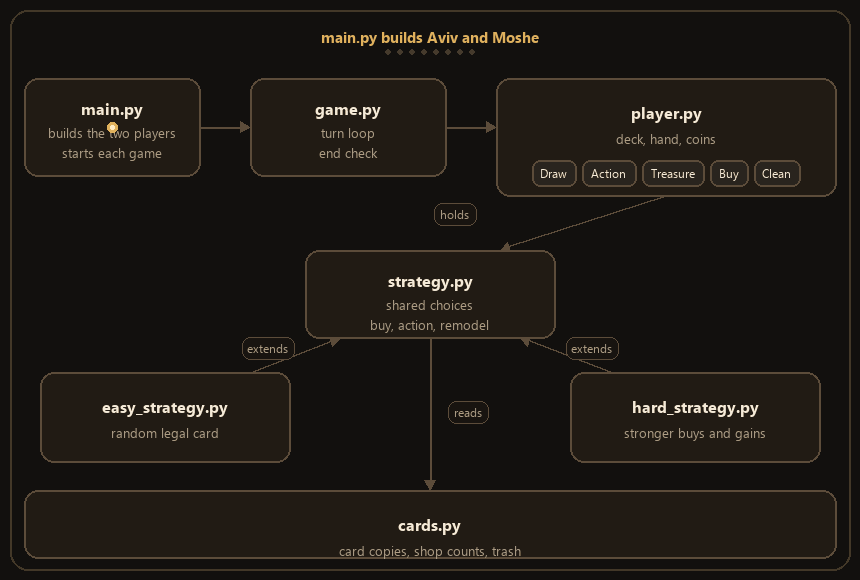

# Dominion

A two-player card game in Python. Aviv buys at random. Moshe buys the strongest card he can afford. One hundred games decide who comes out ahead.

Each turn draws a hand, plays actions, counts coins, buys one card, and cleans up. The game ends when three shop piles are empty, or when the Province pile is empty. The higher victory-point total wins. A tie is a draw.

## Play

From the project folder:

```powershell
python main.py
```

The program prints every shuffle, action, and buy, then the winner of that game. At the end it prints how many games went to Aviv, to Moshe, and to a draw. Each of the 100 passes plays one game and counts that same result.

Four small checks sit in `test_rules.py`. They cover the winner, a Remodel that changes victory points, the hard buy, and a shop with nothing left to buy. Run them with:

```powershell
python -m unittest test_rules.py
```

## The two players

Both players share the same turn and the same action order: Village first, then Remodel or Smithy. Remodel is skipped when it is the only card in hand.

`affordable_card_names` lists the cards still in the shop that the player can pay for.

Aviv uses `EasyStrategy`. His buy is a random card from that list. For Remodel he trashes a random card from his hand, and gains a random card he can afford.

Moshe uses `HardStrategy`. He keeps only the highest cost on that list, and picks at random when two cards share it. With no coins he does not buy. For Remodel he trashes an Estate if he has one, otherwise a Copper, otherwise the cheapest card. The gain tries Province, then Gold, then Smithy or Remodel.

## Architecture



The light follows one turn. `Player` holds a `Strategy`. `EasyStrategy` and `HardStrategy` extend that shared strategy. They choose. The player carries the choice out.

| File | Owns |
| --- | --- |
| `main.py` | Builds the two players, plays 100 games, and counts the results. |
| `game.py` | Resets the table, runs the turn loop, and names the winner. |
| `player.py` | One player's deck, hand, coins, actions, buys, and the steps of a turn. |
| `strategy.py` | Shared choices. The base buy is a random affordable card. |
| `easy_strategy.py` | The random Remodel trash. The buy comes from the base strategy. |
| `hard_strategy.py` | The highest affordable buy, and the stronger Remodel picks. |
| `cards.py` | Card descriptions, shop counts, and the trash. |

Imports point one way. `cards.py` does not import the other game files. Strategies import `cards.py`. `player.py` imports `cards.py` and `strategy.py`. `game.py` imports the shop and `Player`. `player.py` does not import `game.py`.

A strategy never sees the `Player` class. The player passes in a hand or a coin total. The strategy returns a choice. The player then plays, buys, or trashes.

Card descriptions live in one dictionary, `cards`, keyed by `CardName`. `Card.create` copies a description into a new object, so a gained card does not change the shared original. The shop is a second dictionary: card name to how many copies are left. The player does not own it. A buy removes one copy. Remodel removes one copy when it gains the replacement.

A new player starts with 7 Copper and 3 Estate in the discard pile, and with 3 victory points already counted. The first draw shuffles that pile. `main.py` does not shuffle.

## Still open

The match itself runs. A few names and one design limit are still rough.

- Action effects still branch on the card name. `play_action_card` and `choose_action_card_to_play` each know Village, Smithy, and Remodel. A new action card means another branch.
- The end check takes exactly two players. A third player would need a new loop.
- A few names are still drafts: `drow_p`, `print_dack`, `count_empty_paket_in_shop`, and `enter_victory_points_to_your_dack`.

<details>
<summary>Skills practiced in this project</summary>

- Give each file one job, and keep `main.py` free of the rules.
- Put each pile with its owner: the deck stays on the player, the shop and the trash stay in `cards.py`.
- Give the player a strategy object, instead of writing one set of choices into `Player`.
- Keep the shared choices on `Strategy`, and let Easy and Hard override only the choices they change.
- Reset the shop, the trash, and both players before the next game.
- Notice when a new action card still needs another `if card.name` branch.

</details>
